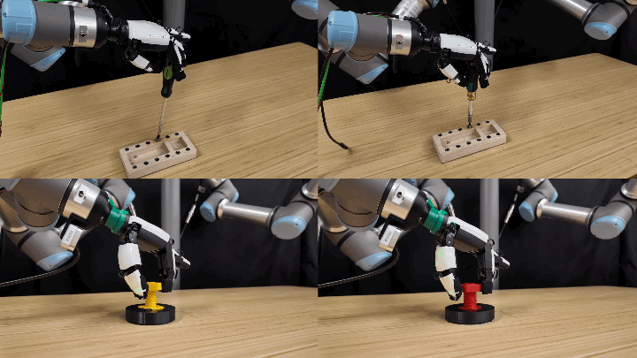

# Learning Dexterous Manipulation Skills from Imperfect Simulations
<a href="https://dexscrew.github.io/"><strong>Project Page</strong></a>
|
<a href="https://arxiv.org/abs/2512.02011"><strong>arXiv</strong></a>
|
<a href="./README_CN.md"><strong>中文说明</strong></a>

[Elvis Hsieh*](https://elvishh77.github.io/),
[Wen-Han Hsieh*](https://wen-hanhsieh.github.io/),
[Yen-Jen Wang*](https://wangyenjen.github.io/),
[Toru Lin](https://toruowo.github.io/),
[Jitendra Malik](https://people.eecs.berkeley.edu/~malik/),
[Koushil Sreenath†](https://hybrid-robotics.berkeley.edu/koushil/) 
[Haozhi Qi†](https://haozhi.io/),<br>
∗: Equal contribution (listed in alphabetical order). †: Equal advising. <br>



## Installation

See [installation instructions](docs/install.md).

## Introduction

Our method contains the following four steps.
1. Learn a oracle policy with privileged information and point-clouds with RL in simulation.
2. Learn a padapt-based student policy using the oracle policy in simulation.
3. Using the trained rotation policy as motion prior, we leverage teleoperation to collect trajectories with downward motion and tactile sensing in real world.
4. Train a behavior cloning policy with expert trajectories to fuse extra observations.

The following session only provides example script of our method. For baselines, checkout [baselines](docs/baseline.md).

补充DOTPG算法

## Step 1: Oracle Policy Training

To train an oracle policy $f$ with RL, run

```
# 0 is GPU is
# 42 is experiment seed
scripts/screwdriver_teacher.sh 0 42 output_name
```

After training your oracle policy, you can visualize it as follows:
```
scripts/vis_screwdriver_teacher.sh 0 42 ckpt_name
```

## Step 2: Sensorimotor policy Training

In this section, we train a sensorimotor policy by distilling from our trained oracle policy $f$.

Note we use the proprioceptive adapt to train the sensorimotor policy.

```
scripts/screwdriver_student_padapt.sh 0 42 output_name
```

## Extra Task: RBHand + Lightbulb (RBHandHoraLightbulb)

This repo also includes an RBHand + lightbulb variant task (`RBHandHoraLightbulb`).
Implementation note: the task is mapped to `RBHandHora` (`dexscrew/tasks/rbhand_hora.py`) to avoid future ambiguity (it currently reuses the same implementation as `XHandHora`).

Train PPO teacher:
```bash
# defaults can be overridden via env var: NUM_ENVS
bash scripts/rbhand_lightbulb_teacher.sh 0 42 rbhand_lightbulb_teacher_v4
```

Test/visualize PPO teacher:
```bash
# NOTE: pass an explicit .pth path (avoid wildcard patterns like best_reward_*.pth)
bash scripts/vis_rbhand_lightbulb_teacher.sh 0 42 \
  outputs/RBHandHoraLightbulb_teacher/rbhand_lightbulb_teacher_v4/stage1_nn/best_reward_848.13.pth
```

Train DOTPG student (student-state; no privileged info as policy input):
```bash
bash scripts/rbhand_lightbulb_student_dotpg_student.sh 0 42 <TEACHER_CKPT>

# Full example:
bash scripts/rbhand_lightbulb_student_dotpg_student.sh 0 42 \
  outputs/RBHandHoraLightbulb_teacher/rbhand_lightbulb_teacher_v4/stage1_nn/best_reward_848.13.pth
```

Test/visualize DOTPG student (student-state):
```bash
bash scripts/vis_rbhand_lightbulb_student_dotpg_student.sh 0 42 <STUDENT_CKPT>

# Full example:
bash scripts/vis_rbhand_lightbulb_student_dotpg_student.sh 0 42 \
  outputs/dotpg_rbhand_lightbulb_student_student/student_output/dotpg_nn/model_best.ckpt

# Optional: disable solid axes overlay
# task.env.viewer.draw_axes=False
```

### Extension: DOTPG Student Training (off-policy imitation)

This fork extends DexScrew with a DOTPG student implementation that learns from an expert buffer collected from the PPO teacher.

#### Student-state (recommended; no privileged info as policy input)

In this mode, the DOTPG policy input matches the original student (uses `obs + proprio_hist -> extrin_pred`) and does not take privileged info as policy input.

Train DOTPG (student-state mode):
```bash
# <TEACHER_CKPT> example: outputs/XHandHoraScrewDriver_teacher/<output_name>/stage1_nn/last.pth
# defaults can be overridden via env vars: NUM_ENVS / ADAPT_WARMUP_STEPS / WARMUP_STEPS / EXPL_NOISE
scripts/screwdriver_student_dotpg_student.sh 0 42 <TEACHER_CKPT>

# Full example (from this repo):
scripts/screwdriver_student_dotpg_student.sh 0 42 outputs/XHandHoraScrewDriver_teacher/output_name/stage1_nn/best_reward_2173.13.pth
```

Test DOTPG (student-state; deterministic; no teacher ckpt needed at eval time):
```bash
scripts/vis_screwdriver_student_dotpg_student.sh 0 42 <STUDENT_CKPT> \
  task.env.reset_dist_threshold=0.15

# Full example (from this repo):
scripts/vis_screwdriver_student_dotpg_student.sh 0 42 outputs/dotpg_student_student/student_output/dotpg_nn/model_best.ckpt \
  task.env.reset_dist_threshold=0.15
```

#### Teacher-state (uses privileged info as policy input; for debugging/upper bound)

In this mode, the DOTPG policy input directly aligns with the PPO teacher input:
`obs + tanh(cat(env_mlp(priv_info), point_mlp(point_cloud)))`. This uses privileged info (and point cloud) as part of the policy input.

Train DOTPG (teacher-state mode):
```bash
# <TEACHER_CKPT> example: outputs/XHandHoraScrewDriver_teacher/<output_name>/stage1_nn/last.pth
# You can override defaults via env vars: NUM_ENVS / WARMUP_STEPS / EXPL_NOISE
scripts/screwdriver_student_dotpg.sh 0 42 <TEACHER_CKPT>

# Full example (from this repo):
scripts/screwdriver_student_dotpg.sh 0 42 outputs/XHandHoraScrewDriver_teacher/output_name/stage1_nn/best_reward_2173.13.pth
```

Test DOTPG (teacher-state; deterministic; requires both teacher+student checkpoints):
```bash
# checkpoint=<TEACHER_CKPT>, train.load_path=<STUDENT_CKPT>
bash scripts/screwdriver_student_dotpg.sh 0 42 <TEACHER_CKPT> \
  test=True wandb_activate=False \
  train.load_path=outputs/dotpg_student/student_output/dotpg_nn/model_best.ckpt \
  num_envs=6 headless=False graphics_device_id=0

# Full example (from this repo):
bash scripts/screwdriver_student_dotpg.sh 0 42 outputs/XHandHoraScrewDriver_teacher/output_name/stage1_nn/best_reward_2173.13.pth \
  test=True wandb_activate=False \
  train.load_path=outputs/dotpg_student/student_output/dotpg_nn/model_best.ckpt \
  num_envs=6 headless=False graphics_device_id=0
```

## Step 3: Rotational Policy deployment in Real Hardware

To generate the rotational policy from the student policy $\pi$, run
```
scripts/convert_student_jit.sh
```

To deploy rotational policy on real hardware, please refer to `./xhand-deploy`.

## Step 4: Real-world Fine-tuning

See the following repository: [skill-teleop](https://github.com/x-robotics-lab/skill-teleop)

## Acknowledgement

This repository is built based on [penspin](https://github.com/HaozhiQi/penspin/), [Hora](https://github.com/HaozhiQi/hora) and [IsaacGymEnvs](https://github.com/isaac-sim/IsaacGymEnvs), and supported in part by the program "Design of Robustly Implementable Autonomous and Intelligent Machines (TIAMAT)", Defense Advanced Research Projects Agency award number HR00112490425. We thank Mengda Xu for his valuable feedback.

## Citation

If you find **dexscrew** or this codebase helpful in your research, please cite:

```
@article{hsieh2025learning,
  title={Learning Dexterous Manipulation Skills from Imperfect Simulations},
  author={Hsieh, Elvis and Hsieh, Wen-Han and Wang, Yen-Jen and Lin, Toru and Malik, Jitendra and Sreenath, Koushil and Qi, Haozhi},
  journal={arXiv:2512.02011},
  year={2025}
}
```
