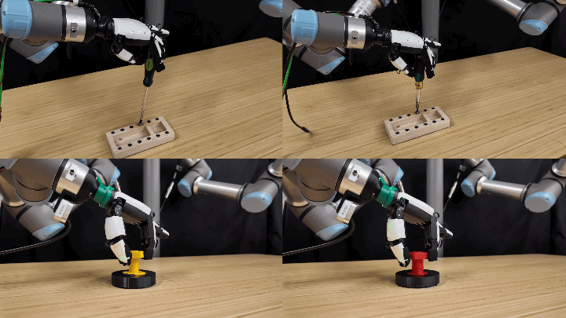

# 从不完美模拟中学习灵巧操作技能（DexScrew）
<a href="https://dexscrew.github.io/"><strong>项目主页</strong></a>
|
<a href="https://arxiv.org/abs/2512.02011"><strong>arXiv</strong></a>



## 安装

请参考 [安装说明](docs/install.md)。

## 常见问题（Isaac Gym Viewer 无响应）

如果运行带 Viewer 的脚本时弹出系统提示：**““Isaac Gym”无响应 您可以尝试等待其响应或强制退出此应用程序”**，可尝试在终端执行：
```bash
sudo prime-select nvidia
export VK_ICD_FILENAMES=/usr/share/vulkan/icd.d/nvidia_icd.json
```

说明：
- `sudo prime-select nvidia` 可能需要注销/重启后生效。
- `export VK_ICD_FILENAMES=...` 只对当前终端会话生效（需要在运行脚本前设置）。

## 简介

原项目方法包含四个步骤：
1. 在仿真中使用 RL 训练带特权信息与点云的教师（oracle）策略。
2. 在仿真中从教师策略蒸馏得到基于 proprio-adapt 的学生策略（ProprioAdapt / DAgger）。
3. 使用训练好的旋转策略作为先验，通过遥操作在真实世界采集带下压动作和触觉传感的轨迹。
4. 使用真实世界专家轨迹做行为克隆微调。

本仓库额外包含 **DOTPG 学生模型（off-policy imitation）** 的可运行版本（详见 `USAGE_GUIDE.md`）。

## 教师（PPO Oracle）：训练与测试

说明：
- 原项目默认使用 **XHand** 灵巧手（任务如 `XHandHoraScrewDriver` / `XHandHoraNutBolt`）。
- 教师策略为 **PPO**，训练时使用 **特权信息（privileged info）+ 点云（point cloud）**。
- 本仓库额外新增了 **RBHand + Lightbulb** 任务（`RBHandHoraLightbulb`），用于验证同一训练链路在不同手/物体模型上的可行性。

### XHand（原项目：ScrewDriver）

训练教师策略（带特权信息与点云）：
```bash
# 0: GPU id
# 42: seed
scripts/screwdriver_teacher.sh 0 42 output_name
```

可视化教师策略：
```bash
scripts/vis_screwdriver_teacher.sh 0 42 ckpt_name
```

### RBHand（扩展任务：Lightbulb）

本仓库也提供了一个 RBHand + lightbulb 的任务变体（`RBHandHoraLightbulb`）。
实现说明：该任务映射到 `RBHandHora`（`dexscrew/tasks/rbhand_hora.py`）以避免后续扩展时的命名歧义（目前仍复用 `XHandHora` 的实现）。

注意：由于 RBHand 本体自由度限制，如果手腕固定在空间中，仅靠手指很难稳定拧动灯泡；因此该环境在训练/测试时启用了 **1-DOF 腕部绕轴转动**（作为 policy 的一个连续动作维度复用到某个 action index 上）。

训练 PPO 教师：
```bash
# 默认可通过环境变量覆盖：NUM_ENVS
bash scripts/rbhand_lightbulb_teacher.sh 0 42 rbhand_lightbulb_teacher_v4
```

测试/可视化 PPO 教师：
```bash
# 注意：这里需要传入明确的 .pth 路径（不要用 best_reward_*.pth 这类通配符）
bash scripts/vis_rbhand_lightbulb_teacher.sh 0 42 \
  outputs/RBHandHoraLightbulb_teacher/rbhand_lightbulb_teacher_v4/stage1_nn/best_reward_848.13.pth
```

### Dexh13（扩展任务：Lightbulb）

本仓库新增了 Dexh13 + lightbulb 的任务变体（`Dexh13HoraLightbulb`）。
与 RBHand 不同，Dexh13 **手腕固定**（不使用 `wrist` 运动学绕轴转动），默认用手掌正对灯泡进行旋拧。

训练 PPO 教师：
```bash
# 默认可通过环境变量覆盖：NUM_ENVS
bash scripts/dexh13_lightbulb_teacher.sh 0 42 dexh13_lightbulb_teacher_v1
```

测试/可视化 PPO 教师：
```bash
bash scripts/vis_dexh13_lightbulb_teacher.sh 0 42 <CKPT_PTH>
```

对位微调（手掌/灯泡初始相对位置）：
- `configs/task/Dexh13HoraLightbulb.yaml`：
  - `env.asset.handRootPos`：平移手根（单位米）
  - `env.asset.handRootQuat`（或新增 `handRootRPY`）：旋转手根
  - `env.object.init_pos` / `env.object.init_pos_noise`：平移灯泡

可视化说明（Dexh13）：
- 之前“看不到手指”最常见原因是：默认相机在手背侧（+X）容易被掌部外壳遮挡。
- 本仓库默认把 `configs/task/Dexh13HoraLightbulb.yaml` 的 `env.viewer.camera_pos` 放到手掌侧（-X）方便观察。
- 任务里用 `right_*_tip` 作为 `fingertipBodies`（更稳定拿到“指尖”位姿）；当前不再渲染彩色 tip 球体，仅保留 tip link 本身用于定位/奖励计算。

开环小测试（Dexh13 手腕固定，指驱“尝试旋拧”）：
```bash
bash scripts/vis_dexh13_lightbulb_finger_twist.sh 0 42
```

多尺度盘查（4×4 可视化；每个 env 固定一个尺寸档位）：
```bash
# NUM_ENVS=16 -> 4×4 布局；四档尺寸（1.0/1.05/1.10/1.15）会按 env_id % 4 分配到不同 env（运行中不变）
NUM_ENVS=16 STEPS=3000 bash scripts/vis_dexh13_lightbulb_finger_twist.sh 0 42
```

常用微调（开环 demo）：
- 拇指横摆根关节（`right_thumb_joint_1`）：`THUMB_J1_BIAS=1.25`（单位 rad；决定拇指从侧面“靠向”灯泡）
- 拇指根（`right_thumb_joint_0`）：`THUMB_ROOT_BIAS=-0.2`（单位 rad；合拢/旋拧时的偏置）
- 让拇指根在旋拧阶段保持不动：`THUMB_TWIST_AMP=0`（推荐）
- 合拢角度（比例 0~1）：
  - 全部手指：`CLOSE_FRACTION=0.65`
  - 仅拇指弯曲关节（`right_thumb_joint_2/3`）：`THUMB_FLEX_CLOSE_FRACTION=0.35`（-1 表示沿用 `CLOSE_FRACTION`）
  - 更“永久”的初始姿态：改 `configs/task/Dexh13HoraLightbulb.yaml` 里的 `env.asset.handInitPose.*`

## 学生：训练与测试（ProprioAdapt/DAgger + DOTPG）

说明：
- 原项目学生为 **ProprioAdapt（DAgger 风格）**：policy 输入以本体感知为主，通过教师监督学习得到可泛化的动作策略。
- 本仓库扩展了 **DOTPG（off-policy imitation）**：使用 PPO 教师收集离线 expert buffer 进行离线/离策略训练。
- 关于“特权信息”：
  - **推荐**使用 `student-state`：policy 输入不包含 `priv_info`（更贴近真机可用输入）。
  - `teacher-state` 会把 `priv_info/点云` 作为 policy 输入的一部分，仅用于对照/上限；**真机实验通常不推荐**。

### ProprioAdapt / DAgger（原项目：XHand）

从教师蒸馏学生策略：
```bash
scripts/screwdriver_student_padapt.sh 0 42 output_name
```

### ProprioAdapt / DAgger（Dexh13：Lightbulb）

从 Dexh13 PPO teacher 蒸馏学生策略：
```bash
# <TEACHER_CKPT> 示例：
# outputs/Dexh13HoraLightbulb_teacher/<output_name>/stage1_nn/last.pth
bash scripts/dexh13_lightbulb_student_padapt.sh 0 42 dexh13_lightbulb_padapt_v1 <TEACHER_CKPT>
```

测试/可视化 ProprioAdapt 学生：
```bash
bash scripts/vis_dexh13_lightbulb_student_padapt.sh 0 42 <STUDENT_CKPT>
```

### student-state（推荐：不使用特权信息作为 policy 输入）

该模式下 DOTPG 的 policy 输入对齐原项目学生：`obs + proprio_hist -> extrin_pred`，**不把 priv_info 当作 policy 输入**。

#### XHand：DOTPG（student-state）

训练 DOTPG（student-state）：
```bash
# <TEACHER_CKPT> 示例：
# outputs/XHandHoraScrewDriver_teacher/<output_name>/stage1_nn/last.pth
#
# 可通过环境变量覆盖默认值：NUM_ENVS / ADAPT_WARMUP_STEPS / WARMUP_STEPS / EXPL_NOISE
scripts/screwdriver_student_dotpg_student.sh 0 42 <TEACHER_CKPT>

# 完整示例（使用本仓库已有 ckpt）：
scripts/screwdriver_student_dotpg_student.sh 0 42 outputs/XHandHoraScrewDriver_teacher/output_name/stage1_nn/best_reward_2173.13.pth
```

测试 DOTPG（student-state；deterministic；评测时不需要 teacher ckpt）：
```bash
scripts/vis_screwdriver_student_dotpg_student.sh 0 42 <STUDENT_CKPT> \
  task.env.reset_dist_threshold=0.15

# 完整示例（使用本仓库已有 ckpt）：
scripts/vis_screwdriver_student_dotpg_student.sh 0 42 outputs/dotpg_student_student/student_output/dotpg_nn/model_best.ckpt \
  task.env.reset_dist_threshold=0.15
```

#### RBHand：DOTPG（student-state，推荐）

训练 DOTPG 学生（student-state；policy 输入不使用特权信息）：
```bash
bash scripts/rbhand_lightbulb_student_dotpg_student.sh 0 42 <TEACHER_CKPT>

# 完整示例：
bash scripts/rbhand_lightbulb_student_dotpg_student.sh 0 42 \
  outputs/RBHandHoraLightbulb_teacher/rbhand_lightbulb_teacher_v4/stage1_nn/best_reward_848.13.pth
```

测试/可视化 DOTPG 学生（student-state）：
```bash
bash scripts/vis_rbhand_lightbulb_student_dotpg_student.sh 0 42 <STUDENT_CKPT>

# 完整示例：
bash scripts/vis_rbhand_lightbulb_student_dotpg_student.sh 0 42 \
  outputs/dotpg_rbhand_lightbulb_student_student/student_output/dotpg_nn/model_best.ckpt

# 可选：关闭实心坐标轴叠加
# task.env.viewer.draw_axes=False
```

#### Dexh13：DOTPG（student-state，推荐）

训练 DOTPG 学生（student-state；policy 输入不使用特权信息）：
```bash
# <TEACHER_CKPT> 示例：
# outputs/Dexh13HoraLightbulb_teacher/<output_name>/stage1_nn/last.pth
#
# 可通过环境变量覆盖默认值：NUM_ENVS / ADAPT_WARMUP_STEPS / WARMUP_STEPS / EXPL_NOISE
bash scripts/dexh13_lightbulb_student_dotpg_student.sh 0 42 <TEACHER_CKPT>
```

测试/可视化 DOTPG 学生（student-state）：
```bash
bash scripts/vis_dexh13_lightbulb_student_dotpg_student.sh 0 42 <STUDENT_CKPT>
```

### teacher-state（使用特权信息作为 policy 输入；不推荐真机，仅用于对照/上限）

该模式下 DOTPG 的 policy 输入直接对齐 PPO teacher：`obs + tanh(cat(env_mlp(priv_info), point_mlp(point_cloud)))`，即 **priv_info/点云是 policy 输入的一部分**。

训练 DOTPG（teacher-state）：
```bash
# <TEACHER_CKPT> 示例：
# outputs/XHandHoraScrewDriver_teacher/<output_name>/stage1_nn/last.pth
#
# 可通过环境变量覆盖默认值：NUM_ENVS / WARMUP_STEPS / EXPL_NOISE
scripts/screwdriver_student_dotpg.sh 0 42 <TEACHER_CKPT>

# 完整示例（使用本仓库已有 ckpt）：
scripts/screwdriver_student_dotpg.sh 0 42 outputs/XHandHoraScrewDriver_teacher/output_name/stage1_nn/best_reward_2173.13.pth

# Dexh13（lightbulb）：
bash scripts/dexh13_lightbulb_student_dotpg.sh 0 42 <TEACHER_CKPT>
```

测试 DOTPG（teacher-state；deterministic；必须同时提供 teacher+student 两个 ckpt）：
```bash
# checkpoint=<TEACHER_CKPT>, train.load_path=<STUDENT_CKPT>
bash scripts/screwdriver_student_dotpg.sh 0 42 <TEACHER_CKPT> \
  test=True wandb_activate=False \
  train.load_path=outputs/dotpg_student/student_output/dotpg_nn/model_best.ckpt \
  num_envs=6 headless=False graphics_device_id=0

# Dexh13（lightbulb）：
bash scripts/vis_dexh13_lightbulb_student_dotpg.sh 0 42 <TEACHER_CKPT> <STUDENT_CKPT>

# 完整示例（使用本仓库已有 ckpt）：
bash scripts/screwdriver_student_dotpg.sh 0 42 outputs/XHandHoraScrewDriver_teacher/output_name/stage1_nn/best_reward_2173.13.pth \
  test=True wandb_activate=False \
  train.load_path=outputs/dotpg_student/student_output/dotpg_nn/model_best.ckpt \
  num_envs=6 headless=False graphics_device_id=0
```

## Step 3：导出并部署（JIT）

将学生策略导出为 TorchScript：
```bash
scripts/convert_student_jit.sh
```

在真实硬件上部署请参考 `./xhand-deploy`。

## Step 4：真实世界微调

参考仓库： [skill-teleop](https://github.com/x-robotics-lab/skill-teleop)

## 输出目录说明

训练输出默认在 `outputs/<output_name>/`：
- 教师（PPO）：`stage1_nn/`（ckpt）与 `stage1_tb/`（TensorBoard）
- 学生（ProprioAdapt / DAgger）：`stage2_nn/` 与 `stage2_tb/`
- DOTPG（默认 `output_name=dotpg_student`）：
  - expert buffer：`outputs/dotpg_student/expert_buffer_teacher.pt`
  - 学生 ckpt：`outputs/dotpg_student/student_output/dotpg_nn/`（例如 `model_best.ckpt`）
- DOTPG student-state（默认 `output_name=dotpg_student_student`）：
  - expert buffer：`outputs/dotpg_student_student/expert_buffer_student_raw.pt`（默认 `train.dotpg.dynamic_state=True`）或 `outputs/dotpg_student_student/expert_buffer_student.pt`（`dynamic_state=False`）
  - 学生 ckpt：`outputs/dotpg_student_student/student_output/dotpg_nn/`（例如 `model_best.ckpt`）

更多 DOTPG 参数与运行说明请看 `USAGE_GUIDE.md`。

## git测试指南
